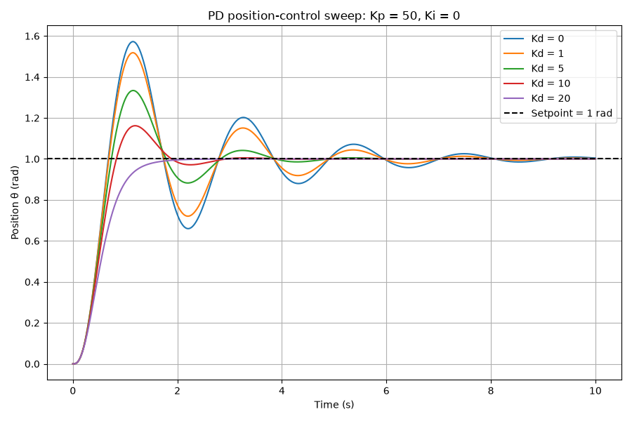
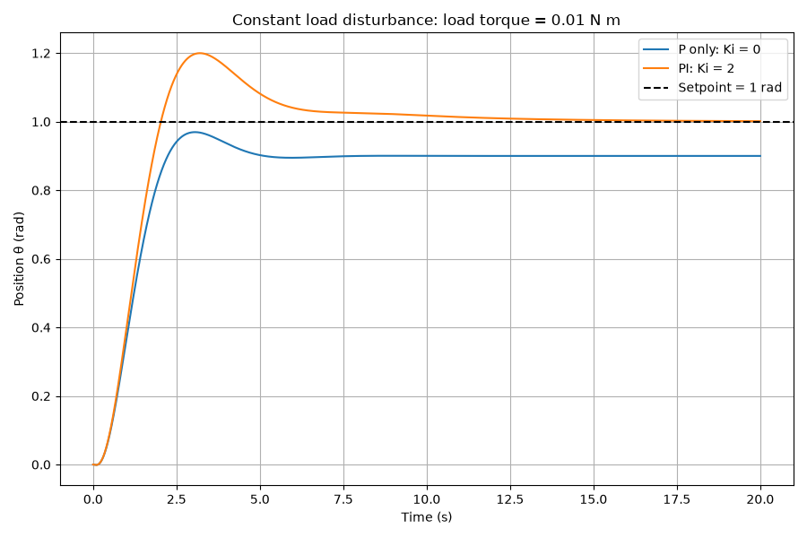
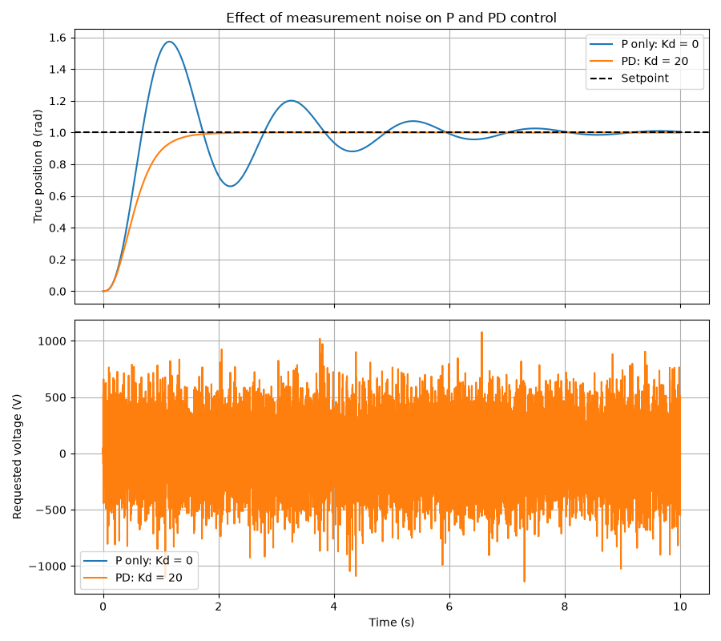

# PID Motor Position Control

A DC motor position-control simulation built in Python and ported to C++. The project models motor electrical and mechanical dynamics, implements a reusable PID controller, and investigates practical control-system trade-offs.

## What this project demonstrates

- P-only gain sweep: increasing Kp speeds up response but can create oscillation and instability.
- Derivative tuning: D action reduces overshoot and settling time in an ideal model.
- Integral tuning: I action removes steady-state error caused by a constant load disturbance.
- Voltage saturation: real motor drivers have finite voltage limits.
- Integral windup and conditional-integration anti-windup.
- Measurement-noise sensitivity: derivative action can produce very noisy voltage commands.
- A matching C++ implementation that exports simulation data to CSV.

## Key results

- With P-only control, Kp = 10 gave a stable response with about 7.7% overshoot.
- Kp = 150 was unstable, consistent with the calculated stability limit near Kp = 120.
- With Kp = 50, increasing Kd from 0 to 20 reduced overshoot from about 57% to 0% in the ideal simulation.
- Under a constant 0.01 N m load torque, P-only control settled at 0.9 rad, while PI control reached approximately 1.0 rad.
- Under a 2 V actuator limit, anti-windup stopped the PID controller from accumulating an impossible voltage request.
- Measurement noise caused the PD controller to generate large high-frequency voltage fluctuations.

## Project structure

```text
python/             Python motor model, PID controller, tests, and experiments
python/experiments/ P, I, D, load, saturation, windup, and noise experiments
cpp/                C++ port of the motor and PID simulation
docs/               Predictions and experiment notes
results/            Python plots
```

## Run Python experiments

Create and activate a virtual environment, then install dependencies:

```powershell
pip install -r requirements.txt
```

Run the P-only sweep:

```powershell
python python/experiments/pid_step.py
```

Run the derivative sweep:

```powershell
python python/experiments/pid_d_sweep.py
```

Run the load-disturbance comparison:

```powershell
python python/experiments/pid_load_compare.py
```

Run the windup demonstration:

```powershell
python python/experiments/pid_windup.py
```

Run the noise experiment:

```powershell
python python/experiments/pid_noise.py
```

## Run the C++ simulation

Compile from the project root:

```powershell
g++ -std=c++17 -Wall -Wextra -I cpp/include cpp/src/main.cpp cpp/src/motor.cpp cpp/src/pid.cpp -o cpp/pid_sim.exe
```

Run the executable:

```powershell
.\cpp\pid_sim.exe
```

The C++ program writes results to:

```text
cpp/results/p_only_kp_10.csv
```

## Selected plots






